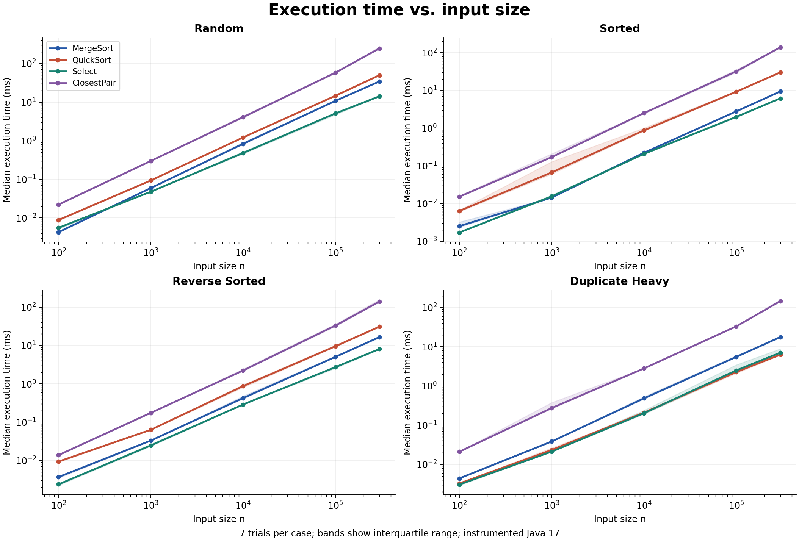
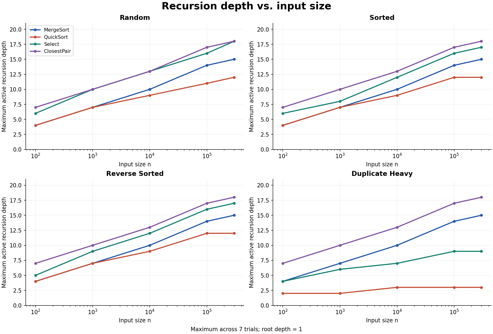
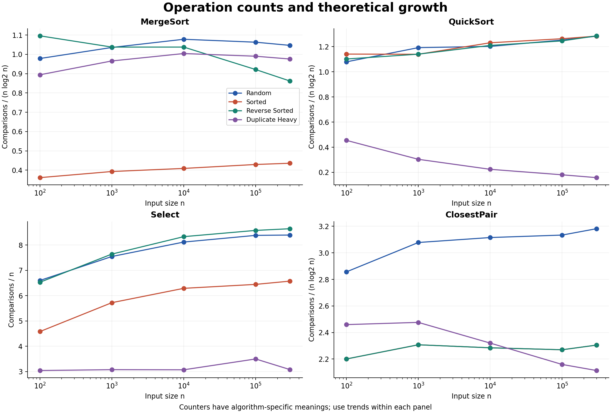
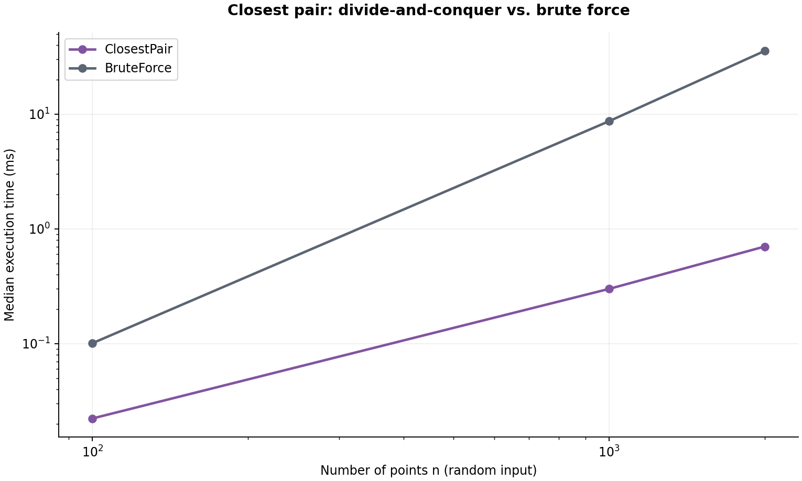
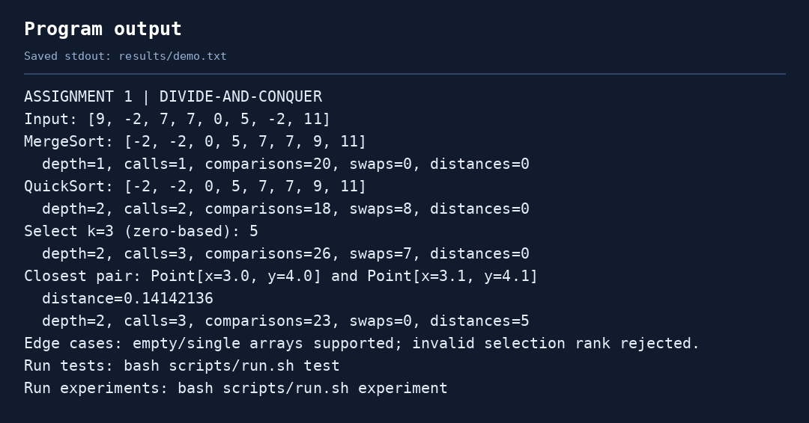
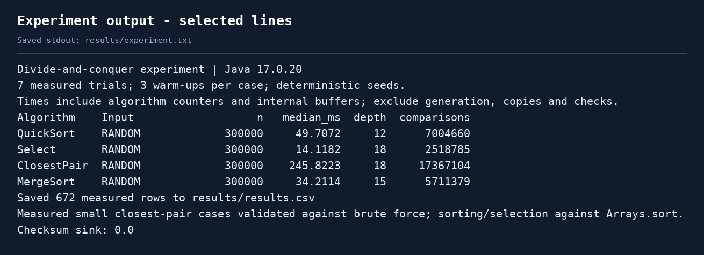

# Assignment 1: Divide-and-Conquer Algorithm Analysis

## A. Project overview

This project implements four divide-and-conquer algorithms in Java 17 and compares their theoretical cost with measured execution time, active recursion depth and operation counts. The implementations are MergeSort, randomized QuickSort, deterministic selection (BFPRT / median of medians), and the closest pair of two-dimensional points.

The Java code has no external runtime or test-library dependencies. The repository includes reproducible inputs, reference-based tests, all raw measurements, plots, saved console output and a Git development history. `k` is **zero-based**: `k = 0` selects the minimum; the experiment selects `k = n / 2` (the upper median for even `n`).

### Run the project

Install/use a **JDK 17 or newer**, with `java` on PATH. Run from the project root.

**Windows PowerShell:**

```powershell
powershell -ExecutionPolicy Bypass -File scripts/run.ps1 demo
powershell -ExecutionPolicy Bypass -File scripts/run.ps1 test
powershell -ExecutionPolicy Bypass -File scripts/run.ps1 experiment
```

The execution-policy option applies only to the launched process. It does not change the permanent Windows policy.

**Linux / macOS / Git Bash:**

```bash
bash scripts/run.sh demo
bash scripts/run.sh test
bash scripts/run.sh experiment
```

**Maven alternative:**

```bash
mvn clean package
java -Xms256m -Xmx1024m -jar target/assignment1-divide-and-conquer-1.0.0.jar demo
java -Xms256m -Xmx1024m -jar target/assignment1-divide-and-conquer-1.0.0.jar experiment
```

The Maven `test` phase runs `daa.AlgorithmTests` through Antrun and fails on a nonzero test exit. Its first run needs access to Maven plugins. The delivered code and tests were compiled/executed directly with OpenJDK 17; Maven and PowerShell were not installed in the measurement environment, so those two launch routes were not executed there. The dependency-free Bash/JDK route was executed successfully.

Regenerate aggregate tables, plots and saved-output images after a new experiment:

```bash
python -m pip install -r scripts/requirements.txt
python scripts/make_report_assets.py
```

To refresh the text captured in the images on Bash, use `bash scripts/run.sh demo > results/demo.txt`, `bash scripts/run.sh test > results/tests.txt`, and `bash scripts/run.sh experiment > results/experiment.txt` before regenerating. Windows users can capture the same commands with `Tee-Object -FilePath results/demo.txt` (and the corresponding test/experiment paths).

### Repository map

| Location | Purpose |
| --- | --- |
| `src/daa/MergeSorter.java` | Stable merge sort, reusable buffer, cutoff 24 |
| `src/daa/QuickSorter.java` | Random pivot, three-way partition, smaller-first recursion |
| `src/daa/DeterministicSelector.java` | In-place groups-of-five selection |
| `src/daa/ClosestPairSolver.java` | Closest pair and quadratic reference |
| `src/daa/Point.java` | Immutable finite-coordinate point |
| `src/daa/Experiment.java` | Warm-up, timing, metrics and CSV output |
| `src/daa/Main.java` | Demo and experiment commands |
| `src/daa/Metrics.java`, `DataSets.java` | Shared counters and input generation |
| `tests/daa/AlgorithmTests.java` | Automated correctness and contract tests |
| `results/` | Raw CSV, aggregates, environment and console logs |
| `docs/plots/`, `docs/screenshots/` | Four plots and three output captures |
| `docs/EXPERIMENT_TABLES.md` | All input-size/type tables |
| `docs/DEFENSE_RU.md` | Russian explanation and defense questions |
| `docs/SUBMISSION_RU.md` | Run and GitHub submission instructions |
| `docs/DAA_Assignment1_Guide_RU.pdf` | Six-page Russian quick-start and defense guide |
| `scripts/` | Portable runners and report regeneration |
| `.github/workflows/java-ci.yml` | Automatic Java 17 build/test configuration for Linux and Windows |
| `pom.xml`, `.gitignore` | Maven configuration and generated-file exclusions |

## B. Algorithm analysis

### MergeSort

The input is divided into two half-open intervals. After both intervals have been sorted, a linear merge combines them. One auxiliary array of length `n` is allocated at the entry point and reused by every recursive call. When an interval contains at most 24 values, insertion sort replaces further recursion. Equality takes the left value first; insertion sort moves only strictly larger values, so the algorithm is stable.

For `n > 24`, ignoring floor/ceiling differences:

`T(n) = 2T(n/2) + Θ(n)`.

Here `a = 2`, `b = 2` and `n^(log_b a) = n`. Master Theorem case 2 gives **Θ(n log n)**. With a fixed cutoff, leaf work does not change the asymptotic result. This implementation still performs each merge on sorted input, so its asymptotic running time remains Θ(n log n), although operation counts improve. Additional storage is **Θ(n)** for the buffer plus **O(log n)** stack frames. Merging two sorted intervals preserves their multiset and produces a sorted interval; induction over the recursive tree establishes correctness.

### Randomized QuickSort

A uniformly random index supplies the pivot. A Dutch-national-flag partition divides the interval into values smaller than, equal to and greater than the pivot. It changes the array in place. The equal interval is finished immediately; this is particularly useful for duplicate-heavy arrays. Only the smaller unequal interval is processed recursively, while the larger interval is handled by the current call's loop.

For distinct values, the expected recurrence is

`E[T(n)] = (2/n) * sum(E[T(k)], k = 0..n-1) + Θ(n) = Θ(n log n)`.

The balanced model `2T(n/2) + Θ(n)` also gives Θ(n log n) by Master case 2, but it is a model, not a proof that every randomized split is balanced. The extreme-pivot recurrence is `T(n) = T(n-1) + Θ(n)`, giving **Θ(n²)**. Equal inputs take **Θ(n)** with three-way partitioning.

Every nested recursive call receives at most half of its parent's current interval. Therefore **O(log n) stack space is guaranteed even in the time worst case**. The optimization changes stack usage, not the worst-case partition work. The partition invariant is written next to the loop in the source; recursively sorting the two unequal intervals completes the sorted array. The algorithm is not stable.

### Deterministic Select: median of medians

Each group of at most five values is insertion-sorted. Its median is moved to a prefix of the same array. A recursive selection on that prefix finds the median-of-medians pivot. A three-way in-place partition then identifies the interval containing rank `k`. The algorithm recurses into only that required interval, or returns immediately if `k` belongs to the equal block. Pivot selection has its own recursive call; it does not mean both outer partitions are searched.

Apart from incomplete groups and rounding, at least half the group medians are on each side of the median of medians. Each qualifying full group contributes at least three values on that side. Consequently at least `3n/10 - O(1)` values can be discarded, and a worst-case upper-bound recurrence is

`T(n) <= T(ceil(n/5)) + T(7n/10 + O(1)) + Θ(n)`.

The ordinary Master Theorem does not directly apply to the unequal subproblem sizes. With **Akra-Bazzi intuition**, choose `p` satisfying `(1/5)^p + (7/10)^p = 1`. Because the left-hand side is 2 at `p = 0` and 0.9 at `p = 1`, `0 < p < 1`. For the upper-bound recurrence, the Akra-Bazzi expression is

`Θ(n^p * (1 + integral[1..n] u/u^(p+1) du)) = Θ(n)`.

Equivalently, the two fractions sum to 0.9, leaving enough slack for the linear grouping and partition work in a substitution proof (absorb rounding into the base case). Selection also requires Ω(n) comparisons in the worst case, giving **Θ(n)** worst-case time. A single active branch shrinks geometrically, so stack space is **O(log n)**. No length-dependent auxiliary array is allocated. Sorting groups, swapping medians and partitioning preserve the original multiset; the partition ranks ensure the chosen branch still contains the required order statistic.

### Closest pair of points

The algorithm first sorts a private copy by x, breaking ties by y. Each recursive call starts with its interval in x-order and finishes with that interval in y-order. Before descending, it saves the split x-coordinate. Each child computes a closest pair; the smaller distance `delta` is the current bound. The two y-ordered intervals are merged in linear time, and the points within `delta` of the dividing line form an already y-ordered strip.

For each strip point, only up to seven following points are considered, stopping earlier when the vertical difference is at least the current best distance. The geometric packing bound limits relevant neighbors. Any closer pair either belongs to one child or crosses the split and lies in this strip; those two cases establish correctness. Coincident points yield distance zero. Splitting by array position remains valid when multiple points have the same x-coordinate.

`T(n) = 2T(n/2) + Θ(n) = Θ(n log n)` by Master case 2. The initial x-sort is also O(n log n), so the total remains **Θ(n log n)**. Sorting the strip from scratch at every call would instead give O(n log² n); this implementation uses merging. Private working, merge and strip arrays consume **O(n)** additional space, and the recursion stack uses **O(log n)**. Java's initial object-array sort may use additional O(n) workspace.

`Math.hypot` avoids the unnecessary overflow/underflow of squaring coordinates. NaN and infinite input coordinates are rejected. Results still use ordinary `double` precision; a true distance above the representable range can be positive infinity. Fewer than two points return a pair with `hasPair() == false` and infinite distance. The caller's input order is preserved.

### Complexity summary

| Algorithm | Time | Additional space, including stack |
| --- | --- | --- |
| MergeSort | Θ(n log n) | O(n) |
| QuickSort | Expected Θ(n log n), worst Θ(n²); all equal Θ(n) | O(log n), even with bad pivots |
| Deterministic Select | Worst Θ(n) | O(log n) |
| Closest Pair | Θ(n log n) | O(n) |

## C. Experimental results

### Method

The saved run used OpenJDK 17.0.20 on Linux amd64 in a shared execution environment; JVM heap options were `-Xms256m -Xmx1024m`. Exact runtime details and timestamp are in [environment.txt](results/environment.txt).

Five main sizes were used: **100, 1,000, 10,000, 100,000 and 300,000**. Integer inputs are random full-range integers, the same seeded integers sorted ascending/descending, or duplicate-heavy values from 0 to 7. Points are random in `[-1,000,000, 1,000,000)²`; sorted/reverse-sorted point inputs refer to lexicographic x/y order, while duplicate-heavy points use an 8-by-8 integer grid.

Before recording data, each main algorithm/input type receives 12 warm-up runs at `n = 10,000`. Each measured case also receives three full-size warm-ups and **seven measured trials**. Cases are shuffled with a fixed seed. Each trial has a different deterministic input seed; matching algorithms receive the same integer or point input for a given size/type/trial. QuickSort's pivot seed is also recorded. Thus datasets and operation counts are reproducible, while elapsed times naturally vary.

Timing uses `System.nanoTime()`. Input generation, the integer working clone, reference sorting and correctness checks are outside the timed region. Algorithm-internal allocation, point copying/sorting, instrumentation and result creation are inside. A volatile checksum retains the result. These are instrumented educational measurements from one JVM process, not isolated JMH microbenchmarks.

The CSV contains **672 raw rows**: 560 main rows, 28 extra fast closest-pair rows at `n = 2,000`, and 84 brute-force rows for `n = 100, 1,000, 2,000`. All measured sorting/selection runs are checked against `Arrays.sort`; measured closest-pair runs with `n <= 2,000` are checked against brute force. Large closest-pair runs use only the fast method, supplemented by the independent large known-distance correctness test.

### Counter definitions

| Counter | Meaning |
| --- | --- |
| `elapsed_ns` | Elapsed timed-region nanoseconds |
| `max_recursion_depth` | Maximum simultaneously active recursive algorithm calls; first call is depth 1 |
| `recursive_calls` | Number of recursive-function entries, including its first entry |
| `comparisons` | Integer comparisons; for points, comparator calls and explicit geometric/distance comparisons |
| `swaps` | Integer swaps between distinct indices |
| `array_writes` | Explicit writes tracked in our code, including counted array copies |
| `distance_evaluations` | Number of `Math.hypot` distance computations |
| `buffer_elements` | Explicit algorithm buffer slots: n for MergeSort, 3n references for ClosestPair, 0 for QuickSort/Select |

Library-sort recursion, writes and temporary allocations are not included in those corresponding counters; its comparator calls **are** counted. `buffer_elements` is not a complete memory profiler. Loops do not increase recursion depth. The nonrecursive brute-force reference has depth 0. Trivial sort calls that do not enter a recursive method also have depth 0. Counts for different algorithms are not identical kinds of CPU work.

### Time on random inputs

Median milliseconds over seven measured trials:

| n | MergeSort | QuickSort | Select | ClosestPair |
| --- | --- | --- | --- | --- |
| 100 | 0.0043 | 0.0089 | 0.0056 | 0.0223 |
| 1,000 | 0.0597 | 0.0938 | 0.0480 | 0.3001 |
| 10,000 | 0.8350 | 1.2187 | 0.4832 | 4.0844 |
| 100,000 | 10.7726 | 14.5749 | 5.1023 | 57.7653 |
| 300,000 | 34.2114 | 49.7072 | 14.1182 | 245.8223 |

### Input structure at n = 300,000

Median milliseconds:

| Input type | MergeSort | QuickSort | Select | ClosestPair |
| --- | --- | --- | --- | --- |
| Random | 34.2114 | 49.7072 | 14.1182 | 245.8223 |
| Sorted | 9.4351 | 30.2245 | 6.1840 | 139.8686 |
| Reverse Sorted | 16.5764 | 30.9663 | 8.0778 | 139.6626 |
| Duplicate Heavy | 17.6562 | 6.2484 | 7.0523 | 145.2728 |

### Recursion depth on random inputs

Maximum depth observed across seven trials:

| n | MergeSort | QuickSort | Select | ClosestPair |
| --- | --- | --- | --- | --- |
| 100 | 4 | 4 | 6 | 7 |
| 1,000 | 7 | 7 | 10 | 10 |
| 10,000 | 10 | 9 | 13 | 13 |
| 100,000 | 14 | 11 | 16 | 17 |
| 300,000 | 15 | 12 | 18 | 18 |

Complete time and depth tables for **every** input size/type appear in [EXPERIMENT_TABLES.md](docs/EXPERIMENT_TABLES.md). [summary.csv](results/summary.csv) also contains quartiles and minimum/maximum times; [results.csv](results/results.csv) retains every trial.

### Plots



Shaded bands show the interquartile range. Both time axes and input-size axes are logarithmic.



The x-axis is logarithmic and the depth axis is linear.





## D. Discussion

**Do the results match the theoretical complexity?** The operation counts are consistent with the bounds. On random inputs from 1,000 to 300,000 values, MergeSort comparisons divided by `n log2 n` stay near 1.04-1.08. QuickSort stays near 1.19-1.28, and ClosestPair's tracked comparisons near 3.08-3.18 under its different counter definition. Select comparisons divided by `n` increase from about 7.55 to 8.40 and then level off. These finite observations support the analysis but cannot prove asymptotic bounds or eliminate worst cases.

**How does input structure affect performance?** Sorted input reduces insertion-sort work inside MergeSort and selection's groups. This run shows lower elapsed times for sorted arrays, without changing their worst-case bounds. Randomizing QuickSort pivots prevents sorted input from automatically causing extreme partitions. Three-way partitioning makes duplicate-heavy QuickSort especially effective: at 300,000 elements its observed maximum depth is 3, versus 12 for random input. Sorting points that are already in x-order is cheaper for Java's adaptive object-array sort. Duplicate points let geometric searches reach zero distance, although recursive merges still execute.

**Why does smaller-first recursion help QuickSort?** The recursive side is no larger than half the unresolved interval, so the nesting depth is bounded logarithmically. The larger side reuses the current stack frame. A forced maximum-pivot test on 2,000 descending values performs over one million comparisons but has depth 1. This demonstrates why stack depth and total running time must be discussed separately.

**Why does median of medians guarantee O(n)?** Groups of five provide both a cheap local median and a guaranteed constant-fraction discard. Pivot selection uses about n/5 values and the remaining selection branch has at most about 7n/10; their total fraction is below 1. Duplicates enter a separate equal block and do not invalidate progress. Constant factors explain why linear selection is not automatically fastest for every tiny input, and selection solves a smaller task than sorting the entire array.

**Why is divide-and-conquer closest pair faster than O(n²) for large inputs?** Brute force computes `n(n-1)/2` pair distances. The fast algorithm checks only a bounded number of strip neighbors at each recursion level, plus sorting and linear merges. The direct comparison on random inputs is:

| n | Divide-and-conquer, ms | Brute force, ms | Observed speedup |
| --- | --- | --- | --- |
| 100 | 0.0223 | 0.1008 | 4.5x |
| 1,000 | 0.3001 | 8.6855 | 28.9x |
| 2,000 | 0.7016 | 35.5501 | 50.7x |

At 2,000 points, the quadratic reference evaluates exactly 1,999,000 pairs; its measured median is about 50.7 times the fast solver's median. No quadratic run was attempted for the 100,000/300,000-point experiment cases. Comparisons of ClosestPair with integer sorting are not rankings for the same task: point objects and Euclidean distance calculations have different costs.

**What practical factors affect performance?** JIT compilation, inlining, branch prediction, allocation, garbage collection, cache locality and shared-host scheduling all matter. Primitive integer arrays have better locality than point references. The fixed insertion cutoff reduces recursive overhead but was not tuned for this machine. Fixed warm-ups, seeded data, shuffled cases and medians reduce some variability; they do not remove GC pauses, order effects or the lack of independent JVM forks. The largest random ClosestPair case has a noticeable practical cost increase; the normalized operation count is more stable than time. Counters themselves add overhead, so these timings should not be presented as uninstrumented production benchmarks.

## E. Reflection

The main lesson from this implementation is that the recurrence, the number of operations and the call stack describe different aspects of an algorithm. QuickSort makes that distinction particularly clear: replacing one recursive branch with a loop limits memory use even when partition work is quadratic. Reusing MergeSort's buffer also shows how a small implementation decision can avoid unnecessary allocation without changing the recurrence.

The most delicate implementation challenges were maintaining rank boundaries with repeated values in selection and preserving the x/y-order invariant in ClosestPair. Three-way partitioning addresses the first problem, while saving the split coordinate before the children run and merging their y-orders addresses the second. Comparing against simple reference methods was useful for catching edge-case mistakes. A natural next step would be independent JVM forks and a cutoff experiment, keeping correctness checks outside timing and separating counter-enabled from counter-disabled benchmarks.

## F. Output captures

The following images render the exact saved stdout logs for readability. They are reproducible log captures, not screenshots of an IDE or a claimed GitHub session. To supply literal screenshots from your own machine, run the commands above and capture the terminal; the complete source logs are retained alongside the images.






### Correctness coverage

The executed suite reports **24,692 successful checks**:

- **406 datasets per sorter**, each compared with `Arrays.sort`: empty, singleton, duplicates, integer extremes, sorted/reverse/random inputs and cutoff boundaries.
- **7,529 selection ranks** compared with sorted indexing. This includes 500 seeded datasets across four types (125 random-distribution datasets, exceeding the required 100), each checked at a random rank, minimum and maximum; exhaustive ternary arrays up to length 6; and large/boundary cases. Multiset preservation is also checked.
- **175 point datasets** compared with quadratic search, including every type at n = 2,000, repeated coordinates, vertical/horizontal lines, a grid, a crossing pair and small/large magnitudes. A separate 100,000-point line has a known minimum distance of 2.
- Invalid arguments and point coordinates, unchanged point input, all-equal QuickSort, and a forced extreme-pivot stack test.

Tests throw on failure and return a nonzero exit code; they do not rely on Java's disabled-by-default `assert` keyword. The full test log is [results/tests.txt](results/tests.txt).

## Git workflow and submission

The repository's commits record the actual preparation sequence: structure, each algorithm, tests, instrumentation, real experiments, runner fixes and report. The initial complete version is tagged `v1.0`. The GitHub submission update adds automated correctness checks on the real feature branch `ci/automated-tests`, merged into `main` with a merge commit and tagged `v1.1`. Both branches and tags are included in the delivery archive and backup bundle. Use `git log --graph --oneline --all` and `git branch --all` to inspect them. The history is not reconstructed or backdated; commit attribution reflects the author that performed these steps.

The GitHub Actions configuration runs `mvn clean verify` and the packaged demo on Java 17 for both Linux and Windows when changes are pushed or a pull request targets `main`. It is configured but has **not run on GitHub yet**, because the repository has not been published. After pushing, inspect the Actions result rather than assuming it passed. The workflow uses only read access to repository contents. See the official [GitHub Java/Maven workflow guide](https://docs.github.com/en/actions/tutorials/build-and-test-code/java-with-maven).

For later work, create a branch for a concrete change, commit that change, run the tests and merge it into `main`. Use a pull request when reviewing changes on GitHub. Existing merge history is local Git history; no GitHub pull request is claimed to exist.

The assignment requires a **working GitHub repository URL**, submitted in Moodle. The report and analysis are this **README.md**; the Russian PDF is only a supporting guide. A local archive alone is not the submission. Follow [SUBMISSION_RU.md](docs/SUBMISSION_RU.md) to push the included repository, both branches and its tags; uploading files through the website does not preserve this local commit history. Check the rendered README and the repository visibility required by the instructor before submitting the URL.

## References

- Assignment handout: *Assignment 1: Divide-and-Conquer Algorithm Analysis*, supplied course PDF.
- Erik Demaine and Charles Leiserson, MIT 6.046J, [Lecture 6: Order Statistics](https://ocw.mit.edu/courses/6-046j-introduction-to-algorithms-sma-5503-fall-2005/ca4e5673e2b64eacc5691cda564cba49_lec6.pdf), for the median-of-medians selection argument.
- Princeton Algorithms, [ClosestPair documentation](https://algs4.cs.princeton.edu/code/javadoc/edu/princeton/cs/algs4/ClosestPair.html), for the divide-and-conquer closest-pair method and its complexity.

The code uses no external algorithm library. The derivations, counters and experiment discussion above refer to the implementation in this repository.
